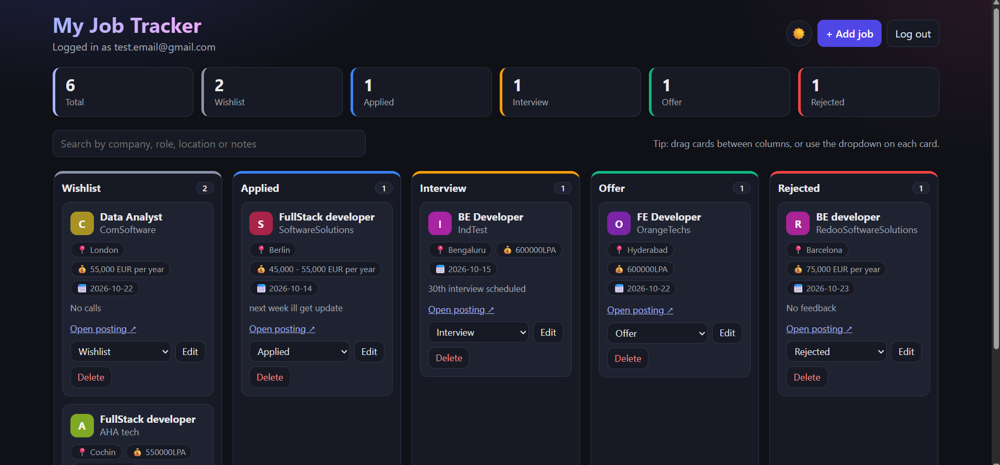
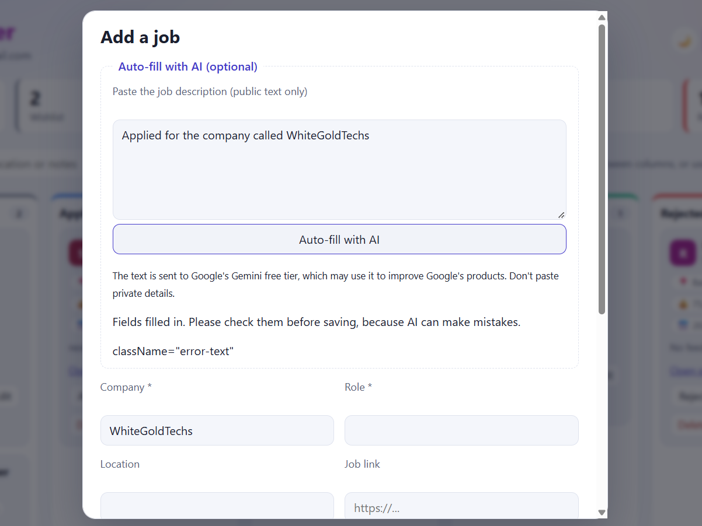

# Job Tracker

A job application tracker with a drag-and-drop board and an AI feature that fills in a job from a pasted description.

**Live demo:** [add your Vercel link here]

## Features

- Sign up, log in, and log out (Supabase Auth)
- Your data is private: each user can only read and change their own jobs
- Add, edit, and delete jobs
- Kanban board with five stages: Wishlist, Applied, Interview, Offer, Rejected
- Drag and drop between columns, with a dropdown on each card as the keyboard and touch alternative
- Optimistic updates: changes appear instantly and roll back if saving fails
- Search by company, role, location, or notes
- Live summary counts
- **AI auto-fill:** paste a job description and the form is filled in for you to review
- Dark and light theme (remembers your choice, follows your system setting at first)
- Responsive layout, loading and error states, keyboard-accessible controls
- 12 automated tests

## Tech stack

React, TypeScript, Vite, React Router, Supabase (Postgres, Auth, Edge Functions), Google Gemini API, Vitest and React Testing Library, deployed on Vercel.

## How it works

- **Database security:** the `jobs` table uses Row Level Security. Policies only let a logged-in user select, insert, update, or delete rows where `user_id` equals their own id. The public key in the browser can't read anyone else's data.
- **AI key stays on the server:** the browser never sees the Gemini key. A Supabase Edge Function checks that the caller is logged in, validates the input length, calls Gemini, and cleans the result before returning it.
- **Prompt injection:** the job text is treated as untrusted data in the instructions, and the function only returns five known fields as trimmed, length-limited strings.
- **Review before saving:** AI output only fills the form. Nothing is saved until the user checks it and clicks Add job.
- **Model name as a setting:** the AI model is set through the `GEMINI_MODEL` secret, so it can be updated when Google retires a model, without changing code.

## Privacy note

The AI feature sends the pasted text to Google's Gemini API. On the free tier, Google may use submitted content to improve its products, so only paste public job descriptions, not personal details.

## Run it locally

1. Clone the repo and run `npm install`
2. Create a Supabase project and run the SQL for the `jobs` table and its policies (see `supabase/schema.sql`)
3. Copy `.env.example` to `.env` and fill in your Supabase URL and publishable key
4. Deploy the Edge Function and set its secret:

   npx supabase functions deploy extract-job --no-verify-jwt
   npx supabase secrets set GEMINI_API_KEY=your_key

5. Run `npm run dev`

Run the tests with `npm run test:run`.

## What I learned

- Writing database security rules instead of trusting the frontend
- Keeping API keys on a server, and validating anything an AI returns
- Optimistic UI updates with rollback
- Accessible alternatives to drag and drop
- Testing components, including mocking the AI call

## Possible improvements

- Per-user limits on AI requests
- Reminders for follow-ups
- Import from a job posting URL

## License

MIT